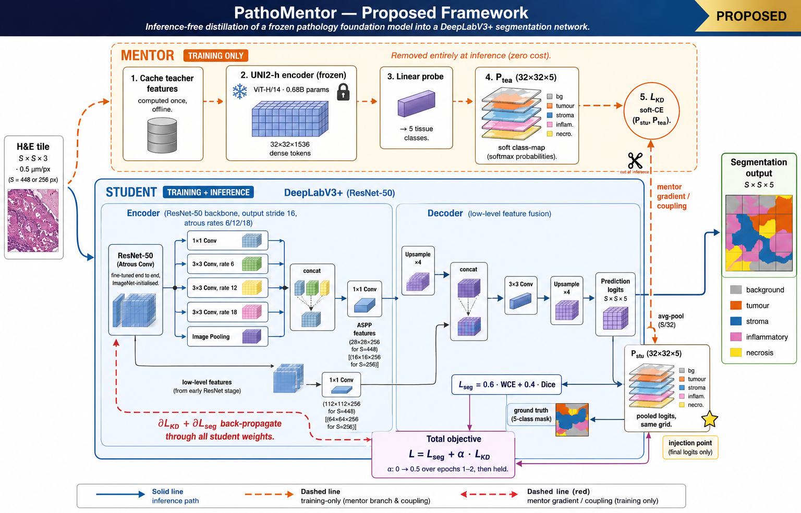
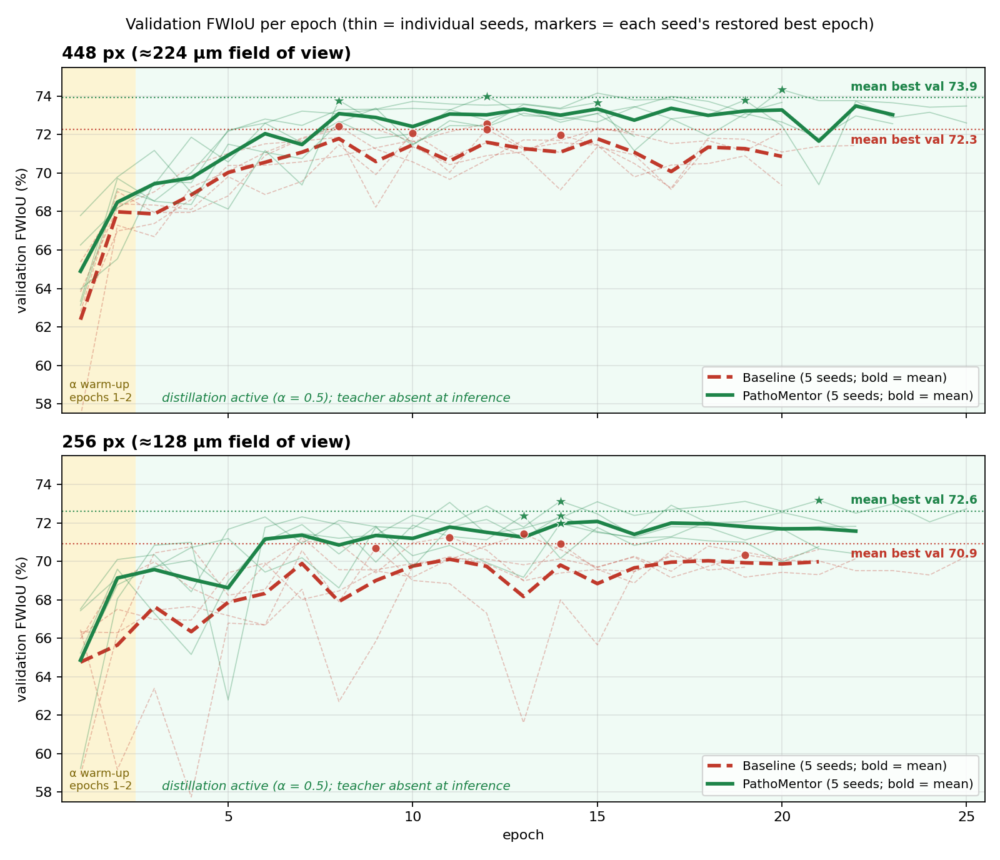
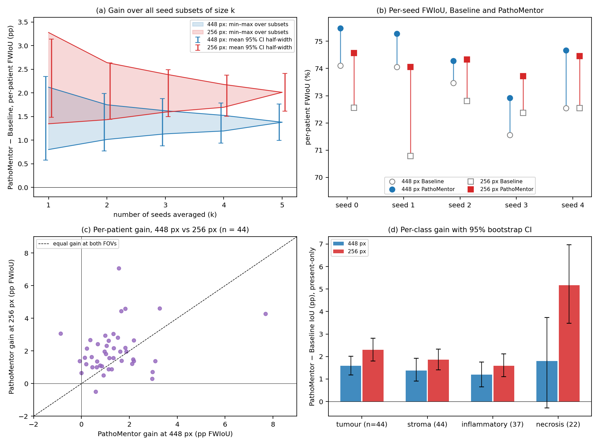
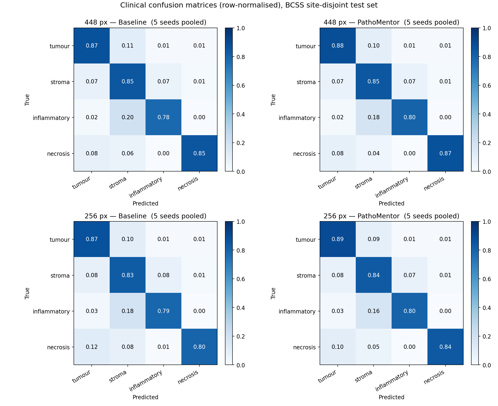

# PathoMentor

**Inference-free distillation of a pathology foundation model for breast cancer tissue segmentation**

PathoMentor trains a lightweight DeepLabV3+ (ResNet-50) segmentation network under the supervision of a frozen
pathology foundation model (UNI2-h). The foundation model is run **once, offline**, to produce dense soft
class-maps; during training the student is asked to match them, and after training the teacher is discarded.
The deployed model is a plain DeepLabV3+: **zero foundation-model parameters and zero extra FLOPs at inference.**

This repository contains the complete, parameterised code used for the paper's experiments: tiling BCSS,
building the UNI2-h teacher cache, training the Baseline and PathoMentor arms at any field of view, evaluating,
segmenting new tiles, and reproducing the paired multi-seed statistics.

> **Paper:** *PathoMentor: Inference-Free Distillation of a Pathology Foundation Model for Breast Cancer Tissue
> Segmentation.* Khaled Metwaly, Eman M. Abd El-Aziz, Aliaa A. A. Youssif. Arab Academy for Science, Technology
> & Maritime Transport. Citation details will be added on publication (see [Citation](#citation)).

---

## Contents

- [Overview](#overview)
- [Results](#results)
- [Installation](#installation)
- [Data preparation](#data-preparation)
- [Building the teacher cache](#building-the-teacher-cache)
- [Training](#training)
- [Evaluation, inference and statistics](#evaluation-inference-and-statistics)
- [Configuration reference](#configuration-reference)
- [Reproducing the paper](#reproducing-the-paper)
- [Repository layout](#repository-layout)
- [Citation](#citation)
- [Licence](#licence)

---

## Overview



Semantic segmentation of tissue compartments in H&E breast cancer histopathology underpins quantitative
analysis of the tumour microenvironment, yet efficient encoder–decoder networks struggle with ambiguous
compartments such as stroma, inflammatory infiltrate and necrosis. Pathology foundation models encode
transferable morphology but are expensive to deploy as dense-prediction backbones. PathoMentor keeps the cheap
network at inference and uses the foundation model only as a *training-time mentor*.

**How it works**

1. **Dense native-resolution teacher (offline, once).** Every training tile is viewed by UNI2-h at the
   448-px-equivalent scale as a 2×2 grid of *native* 224-px windows (no down-scaling), giving a 32×32 grid of
   1536-d tokens. A small probe trained on these tokens turns them into a **32×32×5 soft class-map** (background,
   tumour, stroma, inflammatory, necrosis). For 256-px tiles the tile is up-sampled to 448 first, so the teacher
   always carries the wider context. The maps are cached to disk.
2. **Student.** DeepLabV3+ with an ImageNet-initialised ResNet-50, fine-tuned end to end (output stride 16,
   ASPP rates 6/12/18, stride-4 low-level skip).
3. **Distillation.** The student's logits are average-pooled to 32×32 and matched to the teacher map with a
   soft cross-entropy on clinical cells:
   `L = L_seg + α · L_KD`, with `L_seg = 0.6 · weighted-CE + 0.4 · Dice` (background ignored) and α warmed up
   linearly from 0 to 0.5 over the first two epochs, then held.
4. **Deployment.** Only the DeepLabV3+ weights are saved and used; the teacher is never loaded at inference.
5. **Fair checkpoint selection.** Early stopping, LR scheduling and best-weight restoration all monitor the
   pixel-weighted validation FWIoU. An equal-weight (macro) monitor hides much of the gain on this heavily
   imbalanced benchmark.

Augmentation is photometric (H&E stain jitter, brightness/contrast, hue/saturation) plus horizontal flip and
90° rotation; geometric transforms are applied identically to the teacher map so it stays aligned.

## Results

BCSS, **official site-disjoint split** (test institutions OL, LL, E2, EW, GM, S3), 0.5 µm/px, **five
deterministic seeds per arm**, per-patient analysis (n = 44 test patients; seed-averaged, then paired).
FWIoU = frequency-weighted IoU over the four clinical classes; Macro = mean clinical IoU (ClinMIoU); Micro =
pooled-pixel IoU. Δ and CI in percentage points.

| FOV | Metric | Baseline | PathoMentor | Δ | 95% CI | Wilcoxon p | Patients improved |
|---|---|---|---|---|---|---|---|
| 448 px (≈224 µm) | FWIoU | 73.14 | **74.52** | +1.38 | [+1.03, +1.82] | 2.9×10⁻¹¹ | 41/44 |
| | Micro | 71.94 | 73.36 | +1.42 | [+1.04, +1.85] | 2.0×10⁻¹⁰ | |
| | Macro | 67.68 | 69.16 | +1.48 | [+1.07, +1.92] | 2.5×10⁻⁸ | 39/44 |
| 256 px (≈128 µm) | FWIoU | 72.21 | **74.23** | +2.01 | [+1.64, +2.42] | 3.4×10⁻¹³ | 43/44 |
| | Micro | 70.95 | 73.17 | +2.22 | [+1.83, +2.65] | 3.4×10⁻¹³ | 43/44 |
| | Macro | 66.61 | 69.02 | +2.41 | [+2.04, +2.80] | 1.1×10⁻¹³ | 44/44 |

**Per-class IoU gain** (present-patient subsets, Holm-corrected; **bold** = Holm-significant with CI excluding 0):

| Class | N | Δ at 448 px [95% CI] | Δ at 256 px [95% CI] |
|---|---|---|---|
| Tumour | 44 | **+1.59** [+1.19, +2.02] | **+2.29** [+1.80, +2.85] |
| Stroma | 44 | **+1.37** [+0.90, +1.91] | **+1.86** [+1.40, +2.35] |
| Inflammatory | 37 | **+1.19** [+0.66, +1.75] | **+1.59** [+1.08, +2.10] |
| Necrosis | 22 | +1.80 [−0.21, +3.75] | **+5.17** [+3.51, +7.00] |

**Field of view vs. distillation** (same 44 patients, FWIoU):

| Comparison | Δ (pp) | 95% CI | p |
|---|---|---|---|
| Baseline 448 − Baseline 256 (cost of the smaller FOV) | +0.93 | [+0.22, +1.58] | 0.005 |
| PathoMentor gain at 256 − gain at 448 | +0.63 | [+0.17, +1.11] | 0.005 |
| PathoMentor 256 − Baseline 448 | +1.08 | [+0.43, +1.85] | 0.002 |
| PathoMentor 256 − PathoMentor 448 | −0.30 | [−0.84, +0.28] | 0.13 (n.s.; equivalent within ±1 pp, TOST p = 0.010) |

The gain is positive on every seed at both FOVs (448 px: +1.38/+1.23/+0.80/+1.37/+2.12; 256 px:
+2.00/+3.28/+1.52/+1.35/+1.91), significant at the seed level (paired t, p = 0.003 and 0.004), and positive and
Wilcoxon-significant under all 31 seed subsets at each FOV. At 256 px the mentored arm is also the most
stable configuration (seed SD 0.34 pp vs 0.81 pp for its baseline). PathoMentor removes 6.0% (448 px) and 8.3%
(256 px) of all misclassified test pixels.

| Validation FWIoU over training | Seed and patient robustness |
|---|---|
|  |  |



All tables are also available as CSV in [`docs/results/`](docs/results).

## Installation

Python ≥ 3.9. Training uses TensorFlow/Keras (≥ 2.16 / Keras 3, GPU strongly recommended); the teacher-cache
step uses PyTorch + timm.

```bash
git clone https://github.com/khaled-metwaly/PathoMentor.git
cd PathoMentor
pip install -e .                 # training / evaluation / statistics (TensorFlow)
pip install -e ".[teacher]"      # + PyTorch, timm, huggingface_hub for building the UNI2-h teacher
```

The teacher uses the gated model [`MahmoodLab/UNI2-h`](https://huggingface.co/MahmoodLab/UNI2-h): request
access on Hugging Face and provide a token through `--hf-token` or the `HF_TOKEN` environment variable.
Building the teacher is only needed for the `mentor` arm.

## Data preparation

1. **Get BCSS.** Download the Breast Cancer Semantic Segmentation dataset following the official instructions at
   [PathologyDataScience/BCSS](https://github.com/PathologyDataScience/BCSS), at **0.5 µm/px** (the paper used
   ROIs re-exported at 0.5 MPP from the Digital Slide Archive). Arrange it as

   ```
   bcss_05mpp/
     images/TCGA-XX-XXXX-...png     # RGB ROI
     masks/TCGA-XX-XXXX-...png      # same file name, BCSS label codes
   ```

2. **Tile it** on the official site-disjoint split (labels 1–4 kept, everything else → 0 = ignore; tiles with
   < 10% clinical pixels or < 40% tissue are dropped; train tiles overlap by 50%, val/test tiles do not):

   ```bash
   python teacher/make_patches.py --src bcss_05mpp --out data/bcss_448 --patch-size 448
   python teacher/make_patches.py --src bcss_05mpp --out data/bcss_256 --patch-size 256
   ```

   Output: `data/bcss_448/{train,val,test}/{image,mask}/*.png`, plus `class_weights.json`, `fov_split.csv`
   and `patch_manifest.csv`. Any dataset in the same `image/` + `mask/` layout (masks with 0 = ignore,
   1 = tumour, 2 = stroma, 3 = inflammatory, 4 = necrosis) can be used directly.

## Building the teacher cache

```bash
export HF_TOKEN=hf_...
python teacher/build_teacher_cache.py --train-dir data/bcss_448/train --out-dir teacher/cache_448
python teacher/build_teacher_cache.py --train-dir data/bcss_256/train --out-dir teacher/cache_256
```

This writes `uni2h_native_softmaps_32x32x5.npy` (one 32×32×5 soft map per train tile, float16) and
`uni2h_native_index.json` (tile names, row order). It is resumable: if `--max-hours` is reached, run the same
command again. Only **train** tiles need teacher maps.

## Training

One command = one run (one arm × one FOV × one seed). The arm, FOV, seed and the train/validation/test
folders are all command-line parameters.

```bash
# Baseline, 448 px, seed 0
python -m pathomentor.train --arm baseline --fov 448 --seed 0 \
    --train-dir data/bcss_448/train --val-dir data/bcss_448/val --test-dir data/bcss_448/test \
    --out-dir runs

# PathoMentor, 256 px, seed 3  (--data-root is a shortcut for the three folders)
python -m pathomentor.train --arm mentor --fov 256 --seed 3 --data-root data/bcss_256 \
    --teacher-cache teacher/cache_256/uni2h_native_softmaps_32x32x5.npy --out-dir runs

# or from a YAML file (CLI flags override it)
python -m pathomentor.train --config configs/fov256_mentor.yaml --seed 0
```

Each run writes to `runs/<arm>_fov<fov>_seed<seed>/`:

| File | Content |
|---|---|
| `*.weights.h5` | deployed DeepLabV3+ weights (no teacher) |
| `*_results.json` | config summary, best epoch, convergence flag, pooled test macro/FWIoU/micro, per-class IoU, confusion matrix |
| `*_per_patient.csv` | per-patient macro/FWIoU/micro and per-class IoU (input to the statistics) |
| `*_history.csv` / `.png` | per-epoch validation FWIoU, macro, Dice, train loss and learning rate |
| `config.json` | the exact configuration used |

To run the full design (2 arms × 5 seeds at one FOV): `scripts/run_all_seeds.sh 448 data/bcss_448 teacher/cache_448/uni2h_native_softmaps_32x32x5.npy`
(Windows: `scripts\run_all_seeds.bat`). Each run is a separate process, as in the paper.

## Evaluation, inference and statistics

```bash
# re-score saved weights (optionally boundary-tolerant: ignore a k-px collar around GT borders)
python -m pathomentor.evaluate --weights runs/mentor_fov448_seed0/mentor_fov448_seed0.weights.h5 \
    --fov 448 --test-dir data/bcss_448/test --boundary-k 0 4 8 16

# segment new 0.5-MPP tiles (label PNGs + optional 40% colour overlays); the teacher is not needed
python -m pathomentor.predict --weights runs/mentor_fov448_seed0/mentor_fov448_seed0.weights.h5 \
    --fov 448 --images my_tiles/ --out-dir predictions --overlay

# paired multi-seed statistics for every FOV found, plus the cross-FOV tests when two FOVs are present
python -m pathomentor.compare --runs runs --out-dir compare
```

`compare` pairs the arms per patient after averaging over seeds and reports, for macro, FWIoU and micro:
mean/median/20%-trimmed Δ, Wilcoxon, sign and paired-t tests, bootstrap 95% CIs, Cohen's d_z and the
number of improved patients; per-class Δ with Holm correction; seed-level paired t; best epochs per arm;
and, when two FOVs are available, the four same-patient FOV-vs-distillation comparisons. A claim is flagged
`robust` only if the Wilcoxon (or Holm) p < 0.05 **and** the bootstrap CI excludes 0. Seeds that are not
available for both arms are excluded so the design stays balanced. Figures (confusion matrices, training
curves, per-patient Δ box plots) and `compare_stats.json` are written to `--out-dir`.

## Configuration reference

All defaults are the values used in the paper. Run `python -m pathomentor.train --help` for the full list.

| Option | Default | Meaning |
|---|---|---|
| `--arm` | `baseline` | `baseline` or `mentor` (PathoMentor) |
| `--fov` | `448` | tile size in px at 0.5 MPP (multiple of 32; paper: 448 and 256) |
| `--seed` | `0` | run seed (paper: 0–4); fixes initialisation, shuffling and augmentation |
| `--train-dir`, `--val-dir`, `--test-dir` | – | folders with `image/` and `mask/` (or `--data-root`) |
| `--teacher-cache`, `--teacher-index` | – | teacher soft maps + index (mentor arm) |
| `--class-weights` | auto | `class_weights.json`; defaults to the one next to the train folder |
| `--eff-batch` / `--phys-batch` | 32 / 4 | effective batch via gradient accumulation (8 steps of 4 tiles) |
| `--epochs` | 25 | maximum epochs |
| `--lr` | 1e-4 | Adam learning rate (no weight decay) |
| `--patience` | 8 | early-stopping patience on the monitor |
| `--rlr-patience` / `--rlr-factor` / `--min-lr` | 4 / 0.7 / 1e-7 | ReduceLROnPlateau |
| `--monitor` | `val_fwiou` | checkpoint-selection metric (`val_clinical_miou` = macro, for the ablation) |
| `--ce-weight` / `--dice-weight` | 0.6 / 0.4 | segmentation-loss mix |
| `--alpha-peak` / `--align-ramp` / `--align-warmup` | 0.5 / 2 / 0 | distillation weight schedule |
| `--teach-grid` / `--kd-temp` | 32 / 1.0 | teacher grid and KD temperature |
| `--augment` | `true` | photometric + flip/rot90 augmentation |
| `--backbone-weights` | `imagenet` | `none` for a random-initialised backbone |
| `--max-hours` | 11 | time guard; training stops (best weights kept) when reached |
| `--deterministic` | `true` | TF op determinism + seeded `tf.data` |

Ready-made YAML files for the four paper configurations are in [`configs/`](configs).

## Reproducing the paper

| Step | Command | Paper setting |
|---|---|---|
| Tiles | `teacher/make_patches.py --patch-size {448,256}` | official site-disjoint split, val institutions drawn with `--split-seed 0` |
| Teacher | `teacher/build_teacher_cache.py` | 1,500 probe tiles, 48 tokens/tile, 40 probe epochs |
| Training | `pathomentor.train` × {baseline, mentor} × seeds 0–4 × {448, 256} | 20 runs, one GPU each |
| Statistics | `pathomentor.compare --runs runs` | per-patient n = 44, five seeds |

Notes:

- With op-determinism enabled, a given seed reproduces itself on the same hardware/software stack, and the
  Baseline and PathoMentor arms share the identical initialisation and data order at that seed, so the only
  difference between paired runs is the distillation term.
- The paper's runs were trained on Kaggle GPUs (TensorFlow 2 / Keras 3). Absolute numbers can shift slightly on
  other hardware; the paired, multi-seed comparison is what the paper reports.
- A run whose best epoch lands in the last two epochs is flagged `converged_ok: false`; none of the 20 paper
  runs was.
- Running on Kaggle: see [`docs/kaggle.md`](docs/kaggle.md).
- The evaluation unit is the patient (TCGA barcode extracted from the tile name with `--patient-regex`).

**Smoke test** (synthetic data, CPU, a few minutes, no downloads): `python tests/smoke_test.py`. It runs the
whole pipeline (tiling → dummy teacher cache → both arms × 2 seeds × both FOVs → compare → evaluate →
predict). The dummy teacher has the real file format but random content.

## Repository layout

```
PathoMentor/
├── pathomentor/            # the Python package
│   ├── config.py           #   all options + CLI/YAML parsing
│   ├── data.py             #   tf.data pipelines, augmentation, teacher-cache reader
│   ├── model.py            #   DeepLabV3+ (ResNet-50) and the distillation wrapper
│   ├── losses.py           #   weighted CE + Dice
│   ├── metrics.py          #   macro / FWIoU / micro from one confusion matrix; boundary collar
│   ├── callbacks.py        #   validation metrics, alpha schedule, time guard, LR log
│   ├── train.py            #   python -m pathomentor.train
│   ├── evaluate.py         #   python -m pathomentor.evaluate
│   ├── predict.py          #   python -m pathomentor.predict
│   └── compare.py          #   python -m pathomentor.compare
├── teacher/
│   ├── make_patches.py     # BCSS ROIs -> tiles on the official split
│   └── build_teacher_cache.py  # UNI2-h -> 32x32x5 soft class-maps
├── configs/                # YAML for the four paper configurations
├── scripts/                # run every seed and arm for one FOV
├── tests/smoke_test.py     # end-to-end synthetic test
└── docs/                   # figures, results tables, Kaggle notes
```

## Citation

The paper is under review; the BibTeX entry will be added here on publication. If you use this code, please
also cite the BCSS dataset and UNI2-h:

```bibtex
@article{amgad2019bcss,
  title   = {Structured crowdsourcing enables convolutional segmentation of histology images},
  author  = {Amgad, Mohamed and Elfandy, Habiba and Hussein, Hagar and Atteya, Lamees A. and others},
  journal = {Bioinformatics},
  volume  = {35}, number = {18}, pages = {3461--3467}, year = {2019},
  doi     = {10.1093/bioinformatics/btz083}
}
@article{chen2024uni,
  title   = {Towards a general-purpose foundation model for computational pathology},
  author  = {Chen, Richard J. and Ding, Tong and Lu, Ming Y. and Williamson, Drew F. K. and others},
  journal = {Nature Medicine}, volume = {30}, pages = {850--862}, year = {2024},
  doi     = {10.1038/s41591-024-02857-3}
}
```

## Licence

Code: [MIT](LICENSE). The BCSS dataset is released by its authors under CC0 1.0. UNI2-h is distributed by
MahmoodLab under its own licence and access terms, which apply to the teacher-cache step.

## Acknowledgements

We thank the BCSS authors for releasing the dataset and the MahmoodLab for UNI2-h.
